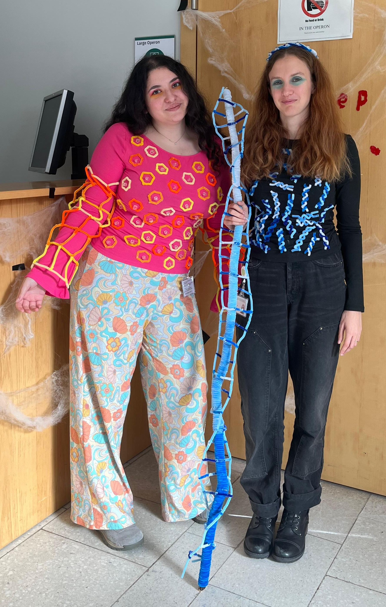



# Lab Members











# Our Pets







# Group Photos



  <figure>
    
    <figcaption>Our first week at EMBL! Don't worry, Dilan has her own office now...</figcaption>
  </figure>

  <figure>
    
    <figcaption>MSB Halloween costume context: Pel and eDNA. We got second place!</figcaption>
  </figure>

